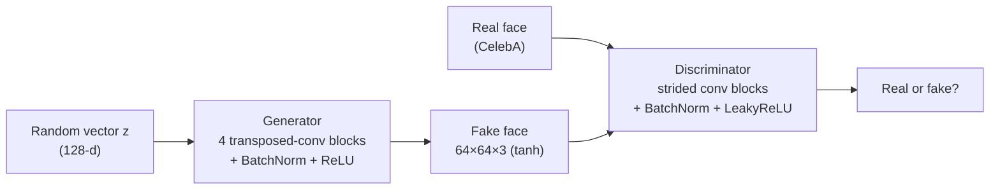

<div align="center">

# 🎭 Face Generation with a DCGAN

**A deep convolutional GAN in PyTorch that learns to generate brand-new 64×64 human faces**

<p>
  
  
  
  
</p>

</div>

---

## 📌 Overview

A **Generative Adversarial Network** pits two networks against each other: a **generator** that turns random noise into images, and a **discriminator** that tries to tell real images from generated ones. As they compete, the generator learns to produce realistic faces that do not belong to any real person.

This repository contains:

1. **`dlnd_face_generation_starter.ipynb`**, the main project: a DCGAN trained on ~32,000 cropped celebrity faces (CelebA) to generate new **64×64×3** faces.
2. **`DCGAN-Training-Solution.ipynb`**, a warm-up exercise that trains a smaller DCGAN on **CIFAR-10** (32×32 images) to practice the training loop.

## 🖼️ Results

Sixteen faces generated from fixed random vectors after training:


Generator and discriminator losses during training:


## 🧠 Architecture



| Setting | Value |
|---|---|
| Latent dimension | 128 |
| Image size | 64 × 64 × 3, scaled to [-1, 1] |
| Batch size | 64 |
| Epochs | 30 |
| Loss | Binary cross-entropy (`BCEWithLogitsLoss`) |
| Optimizer | Adam for both networks |

The generator follows the [DCGAN paper](https://arxiv.org/abs/1511.06434): transposed convolutions double the spatial size at each step (4 → 8 → 16 → 32 → 64), with batch normalization in every block except the output.

## 🗂️ Dataset

A processed subset of [CelebA](http://mmlab.ie.cuhk.edu.hk/projects/CelebA.html) (about 32,000 images), cropped to the face and resized to 64×64. The CIFAR-10 warm-up downloads automatically through `torchvision`.

## 📂 Repository structure

```
├── dlnd_face_generation_starter.ipynb   # main project: DCGAN on CelebA faces
├── DCGAN-Training-Solution.ipynb        # warm-up: DCGAN on CIFAR-10
├── tests.py                             # unit tests for the generator, discriminator and data pipeline
├── train_samples.pkl                    # generated samples saved during training
├── requirements.txt
└── README.md
```

## 🚀 Getting started

```bash
# 1. Clone the repository
git clone https://github.com/hamidghasemi69/Face-Generation-Using-GAN.git
cd Face-Generation-Using-GAN

# 2. (Recommended) create a virtual environment
python -m venv .venv && source .venv/bin/activate
pip install -r requirements.txt

# 3. Launch the notebook
jupyter notebook dlnd_face_generation_starter.ipynb
```

> A GPU is strongly recommended. Training 30 epochs takes about an hour on a single GPU.

## 🙏 Acknowledgements

- Project from the **Udacity** Deep Learning curriculum
- [CelebA dataset](http://mmlab.ie.cuhk.edu.hk/projects/CelebA.html), The Chinese University of Hong Kong
- Radford, Metz & Chintala, [*Unsupervised Representation Learning with Deep Convolutional GANs*](https://arxiv.org/abs/1511.06434) (2015)

## 👤 Author

**Hamidreza Ghasemi** · Principal Data Scientist @ Arizona State University

[](https://hamidghasemi69.github.io)
[](https://www.linkedin.com/in/hamidghasemi69/)
[](https://github.com/hamidghasemi69)

<sub>If you find this project useful, consider giving it a ⭐</sub>
